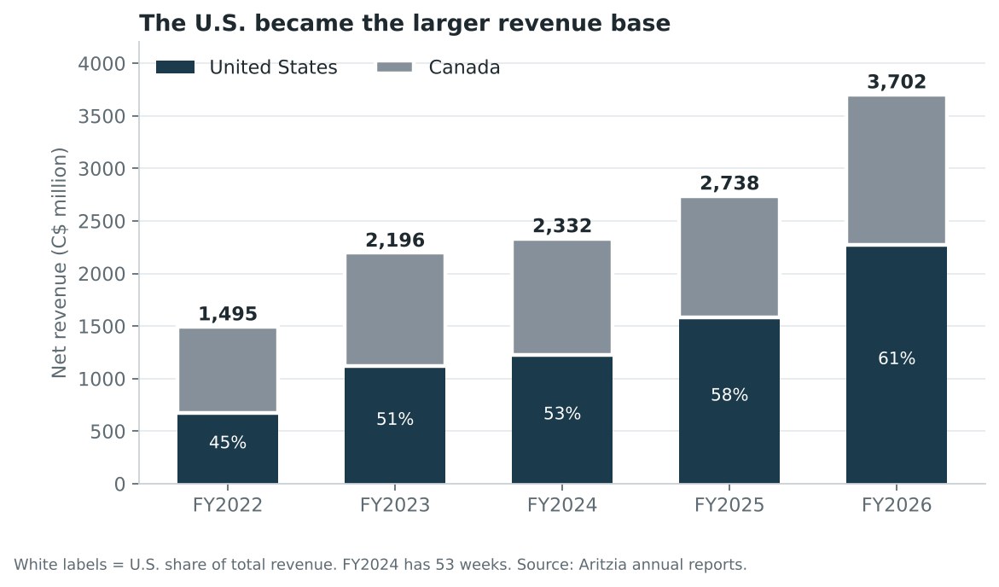
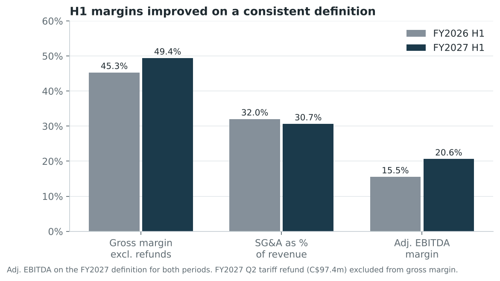
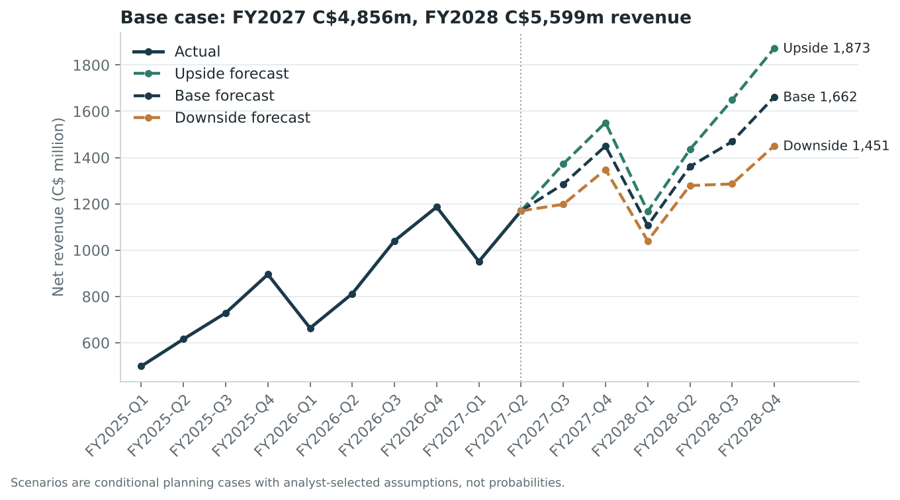

# Aritzia: Is U.S. Expansion Creating Profitable Growth?

**An FP&A case study using public filings: historical diagnosis (FY2022 to FY2027 H1) and a scenario forecast for FY2027 and FY2028.**

Xuerui Zhang · Information cutoff 12 November 2026 · All amounts in C$ million unless stated

[Interactive Tableau dashboard](https://public.tableau.com/app/profile/xuerui.zhang4116/viz/AritziaFPAU_S_ExpansionandProfitableGrowth/Story) · [Excel workbook](data/Aritzia_FPA_Workbook.xlsx) · [Python notebook](notebooks/aritzia_analysis.ipynb)

---

## Business question

> What is driving Aritzia's recent growth, and can its U.S. expansion keep generating *profitable* growth?

"Profitable growth" means revenue growth together with stable or improving gross margin, Adjusted EBITDA margin, SG&A leverage, inventory performance, capital efficiency and cash generation. The project looks at evidence *associated with* U.S. expansion. It does not claim that expansion *caused* the results.

**Audience:** CFO / finance leadership, the FP&A team and U.S. expansion leadership. Secondary: board and investors.

## Key findings

| # | Finding | Evidence |
|---|---|---|
| 1 | **The U.S. supplies most of the growth.** | The U.S. contributed **71.9%** of FY2026 incremental revenue and **80.3%** in FY2027 H1. U.S. revenue mix rose from 45.2% (FY2022) to 61.5% (FY2026). |
| 2 | **Growth is converting into margin.** | FY2027 H1 Adjusted EBITDA margin was **20.6%**, vs 15.5% in FY2026 H1 on the same definition. Gross margin excluding tariff refunds rose from 45.3% to 49.4%; SG&A fell from 32.0% to 30.7% of revenue. |
| 3 | **Cash is strong, but part of it is timing.** | Working capital explains **50.3%** of the FY2026 operating cash flow increase. FY2027 H1 free cash flow stays positive at **C$108.3m** after removing the C$97.4m one-off tariff refund. |
| 4 | **Inventory needs watching.** | FY2027 Q2 inventory grew 35.8%, slower than revenue (44.1%), but inventory days rose from 93.3 to **95.8**. |
| 5 | **The Base forecast sits inside guidance.** | FY2027 revenue **C$4,855.8m** (guidance C$4,780 to 4,880m), Adjusted EBITDA margin 20.1%. FY2028: **C$5,598.9m** revenue (+15.3%) and C$1,140.4m Adjusted EBITDA (20.4%). |







## Scenario forecast

| Fiscal year | Scenario | Revenue | Growth | Adj. EBITDA | Margin |
|---|---|---:|---:|---:|---:|
| FY2027 | Downside | 4,667.2 | 26.1% | 902.1 | 19.3% |
| FY2027 | **Base** | **4,855.8** | **31.2%** | **977.5** | **20.1%** |
| FY2027 | Upside | 5,044.5 | 36.3% | 1,045.5 | 20.7% |
| FY2028 | Downside | 5,056.4 | 8.3% | 920.9 | 18.2% |
| FY2028 | **Base** | **5,598.9** | **15.3%** | **1,140.4** | **20.4%** |
| FY2028 | Upside | 6,124.0 | 21.4% | 1,292.9 | 21.1% |

These are conditional planning cases built on analyst-selected assumptions, not probabilities. FY2027 combines reported Q1 and Q2 with forecast Q3 and Q4. **Sensitivity:** in FY2028, ±1 percentage point (pp) of gross margin moves Adjusted EBITDA by about ±C$56.0m; ±5pp of U.S. growth moves it by about ±C$32.5m.

## Recommendations for FP&A

1. **Plan on the Base case and stress-test with Downside.** Investigate any FY2027 Q3 revenue variance above 5% against the C$1,285.3m Base forecast.
2. **Treat gross margin as the main profit lever.** Track markdowns, freight, tariffs and mix separately. Reforecast if gross margin runs 50 basis points (bps) below plan.
3. **Hold inventory to an ~80-day annual target.** Each extra 5 days adds about C$80.9m to the FY2028 ending inventory requirement.
4. **Phase discretionary capex.** Review FY2028 commitments against the C$300m assumption and re-sequence if demand moves toward Downside. Keep committed capex separate from discretionary spending.
5. **Close the evidence gap on U.S. store returns.** Public data cannot show boutique-level profit or payback. A store-cohort model needs opening dates, selling area, ramp profiles and opening costs.

## Approach

The project follows the six-phase data analysis process. Each phase has its own write-up:

| Phase | What it covers | Document |
|---|---|---|
| Ask | Business task, stakeholders, key questions | [docs/01_ask.md](docs/01_ask.md) |
| Prepare | Data requirements, sources, data inventory, quality checks | [docs/02_prepare.md](docs/02_prepare.md) |
| Process | Cleaning log, comparability adjustments, tidy data model | [docs/03_process.md](docs/03_process.md) |
| Analyze | Growth drivers, profitability, cash, inventory, guidance requirements | [docs/04_analyze.md](docs/04_analyze.md) |
| Share | Tableau Public dashboards and story | [docs/05_share.md](docs/05_share.md) |
| Forecast | Scenario model, guidance check, sensitivity, backtest | [docs/06_forecast.md](docs/06_forecast.md) |

## Repository structure

```
├── README.md
├── data/
│   ├── Aritzia_FPA_Workbook.xlsx   # tidy tables with live formulas; opens in Excel and Tableau
│   └── csv/                        # one CSV per data sheet (values only)
├── docs/                           # phase-by-phase write-ups
├── notebooks/
│   └── aritzia_analysis.ipynb      # reproduces the analysis and rebuilds the forecast in pandas
├── images/                         # charts used in this README
└── tableau/
    └── README.md                   # dashboard structure, data sources and build decisions
```

**Workbook design:** each data sheet is a single table with one header row and no merged cells, so the same file works in Excel, Tableau and pandas. Reported inputs are blue, formulas black and cross-sheet links green; forecast assumptions are highlighted yellow. Changing an assumption updates every forecast, guidance check and sensitivity. `Data_Dictionary` defines all fields and classifies each as reported or calculated, IFRS or non-IFRS. It also says how Tableau should aggregate it.

**Reproducibility:** the notebook checks that the quarters add up to the annual totals and that the revenue splits add up. It then rebuilds the forecast in pandas and asserts that it matches the Excel model (max difference < 0.000001).

## Data sources

All data come from Aritzia's public disclosures. Full URLs are in the workbook's `Sources` sheet.

- Annual reports and audited financial statements, FY2022 to FY2026
- Quarterly results releases, interim statements and investor presentations, FY2024 Q1 to FY2027 Q2
- FY2027 Q2 MD&A (revised Adjusted EBITDA definition and comparatives) and the 8 October 2026 outlook
- Five Year Strategic Plan, Investor Day, 27 October 2026 (context only)

Investor relations: <https://investors.aritzia.com/financial-reports/default.aspx>

## Limitations

- **Unavailable data:** the company does not disclose geographic profit, boutique-level profit, opening costs or payback. U.S. store ROI and causal effects therefore cannot be measured.
- **Definitions:** Adjusted EBITDA is non-IFRS, and its definition changed in FY2027. Comparisons use the restated FY2026 base (C$659.7m rather than C$646.2m as reported).
- **One-off item:** FY2027 Q2 includes a one-time C$97.4m tariff refund. It is excluded from margin and cash run rates, and future refunds are assumed to be zero.
- **Forecast scope:** this is not a cash-flow forecast. EBITDA minus capex minus inventory build is **not** free cash flow. FX is embedded in the geographic growth assumptions.
- **Seasonality:** quarterly figures are strongly seasonal, so comparisons are always made against the same period last year. FY2024 has 53 weeks.
- **Status:** this is an independent portfolio project, not investment advice, and it is not affiliated with Aritzia.

## Tools

Excel (SUMIFS, SUMPRODUCT, INDEX/MATCH, scenario model) · Python (pandas, matplotlib, Jupyter) · Tableau Public · Git/GitHub
