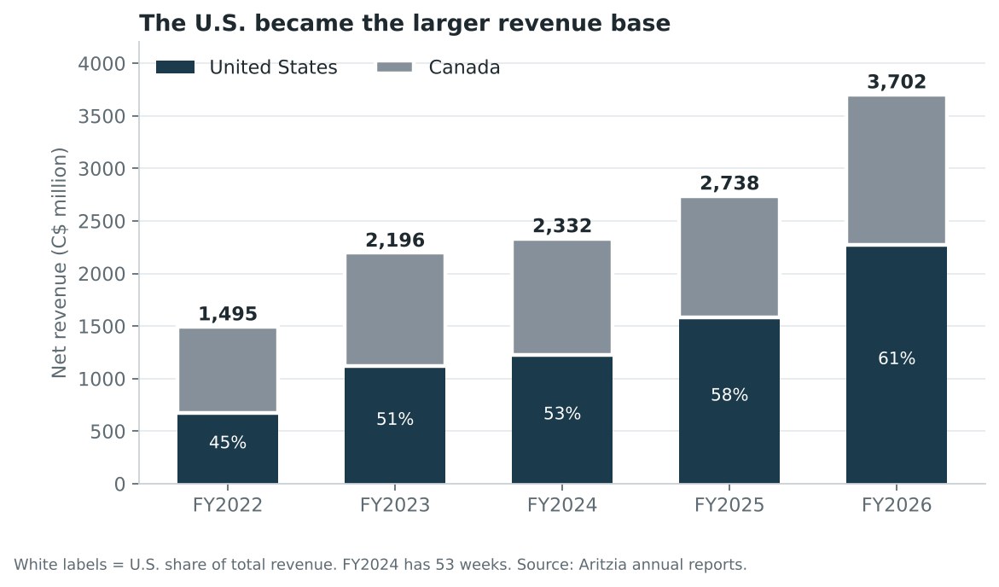
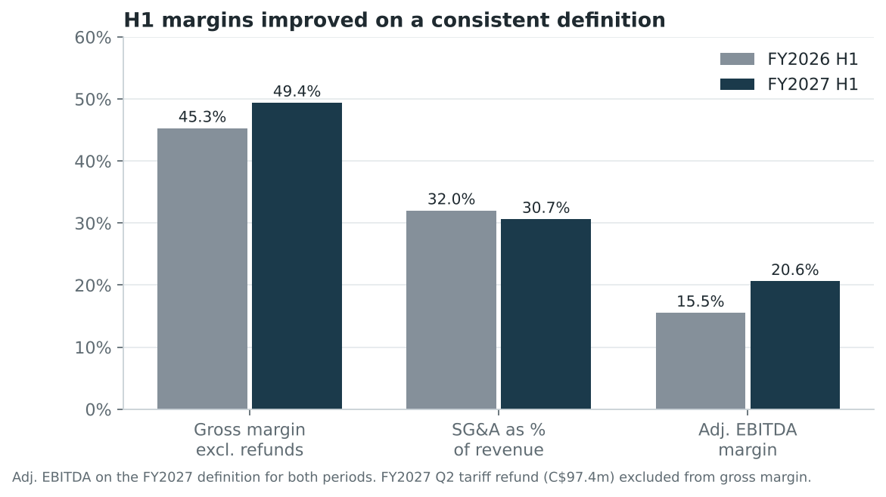
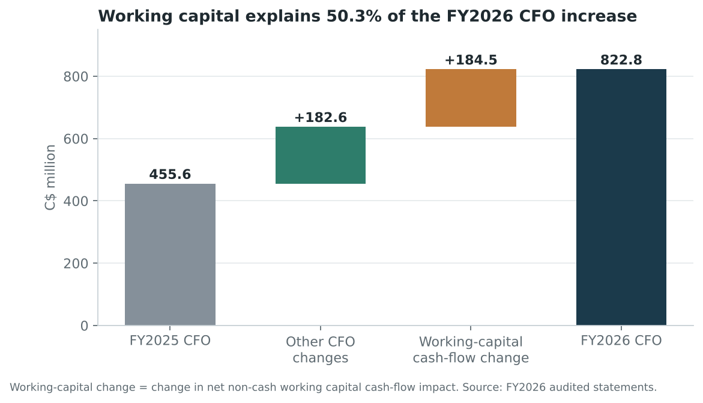
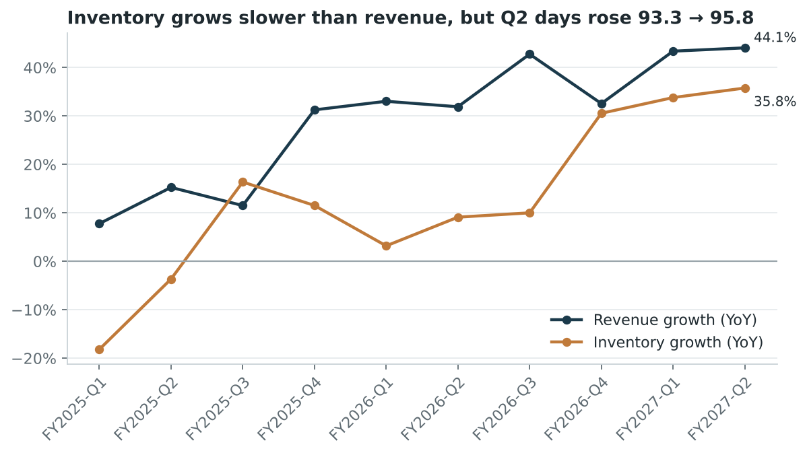

# 4. Analyze: How growth turns into profit and cash

[← Process](03_process.md) · Next: [Share →](05_share.md)

All amounts are C$ million. H1 is the first half of a fiscal year. Worksheet references point to [`Aritzia_FPA_Workbook.xlsx`](../data/Aritzia_FPA_Workbook.xlsx). The same calculations are reproduced in the [notebook](../notebooks/aritzia_analysis.ipynb).

## Analytical framework

The central question breaks into four questions that the data can answer:

| Analytical question | Measures |
|---|---|
| Where is revenue growth coming from? | U.S./Canada and Retail/Digital revenue, comparable sales, boutique counts |
| Is growth translating into profitability? | Gross margin, SG&A % of revenue, Adjusted EBITDA margin, net income margin |
| Can the company fund continued expansion? | Operating cash flow, working-capital effects, free cash flow, capex, net cash |
| How sustainable is recent performance? | Seasonality, one-off items, inventory efficiency, management guidance |

## 1. Revenue growth: rate, mix and contribution

Growth rate, revenue mix and contribution to growth answer different questions:

| FY2026 U.S. measure | Result | Question answered |
|---|---:|---|
| U.S. revenue growth | 43.8% | How fast did the U.S. business grow? |
| U.S. revenue mix | 61.5% | How large is the U.S. in total revenue? |
| **U.S. share of revenue increase** | **71.9%** | How much of the *additional* revenue came from the U.S.? |

`U.S. share of revenue increase = increase in U.S. revenue ÷ increase in total revenue = 693.610 ÷ 964.036 = 71.9%`

For FY2027 H1 the same calculation gives **80.3%**. By channel, FY2027 H1 Digital revenue grew 62.4% and supplied 40.9% of the increase, while Retail grew 36.2%. Company comparable sales grew 34.8%, which points to demand beyond new boutiques. The geography and channel views overlap (U.S. revenue includes U.S. Digital sales), so their contribution shares are never added together.

## 2. Profitability on a consistent basis

### Long-run margins (as originally reported)

| | FY2022 | FY2023 | FY2024 | FY2025 | FY2026 |
|---|---:|---:|---:|---:|---:|
| Gross margin | 43.8% | 41.6% | 38.5% | 43.1% | 44.9% |
| SG&A % of revenue | 26.3% | 27.4% | 30.4% | 30.6% | 29.1% |
| Adj. EBITDA margin | 19.4% | 16.0% | **9.3%** | 14.8% | 17.5% |

The FY2025 and FY2026 improvement is partly a **recovery** from the FY2024 low. FY2026 is still below the FY2022 margin.

### FY2026 EBITDA bridge

| Component | Amount |
|---|---:|
| Revenue growth at the FY2025 margin (scale) | 143.1 |
| Change in EBITDA margin | 96.8 |
| **Total increase in Adjusted EBITDA** | **239.9** |

Both scale and margin contributed. The decomposition is arithmetic: it does not show *which* operating initiatives drove the margin change.

### Latest H1, same definition

| Measure | FY2026 H1 | FY2027 H1 |
|---|---:|---:|
| Revenue | 1,475.4 | 2,120.8 |
| Adj. EBITDA margin (FY2027 definition) | 15.5% | **20.6%** |
| Gross margin excl. tariff refund | 45.3% | 49.4% |
| SG&A % of revenue | 32.0% | 30.7% |

`H1 margin = (Q1 + Q2 Adjusted EBITDA) ÷ (Q1 + Q2 revenue)`, e.g. 437.742 ÷ 2,120.822 = 20.6%.

**Tariff refund check:** FY2027 Q2 reported gross margin was 57.1%. Excluding the C$97.4m refund it was 48.7% (570.011 ÷ 1,169.813). The 57.1% figure cannot be extrapolated.

## 3. Cash-flow quality

| FY2026 vs FY2025 | Amount |
|---|---:|
| Increase in operating cash flow | 367.1 |
| Increase in working-capital cash-flow support | 184.5 |
| **Working-capital share of the CFO increase** | **50.3%** |

About half of the FY2026 CFO increase was working-capital timing, not earnings. Free cash flow excluding working-capital effects was still positive at **298.4** (487.1 − 188.7).

For FY2027 H1, removing the gross tariff receipt reduces free cash flow from 205.7 to **108.3**. This is a sensitivity with cash taxes held unchanged, not a company-defined adjusted measure.

## 4. Inventory efficiency

| FY2027 Q2 vs FY2026 Q2 | Result |
|---|---:|
| Inventory growth | 35.8% |
| Revenue growth | 44.1% |
| Days in inventory | 93.3 → **95.8** |

Inventory is growing more slowly than revenue, but turnover has not improved. Inventory should be monitored against COGS, seasonal buying and the cash tied up in stock.

## 5. What management guidance requires (FY2027 H2)

| | Low | High |
|---|---:|---:|
| FY2027 revenue guidance | 4,780.0 | 4,880.0 |
| Less: H1 actual | 2,120.8 | 2,120.8 |
| **H2 revenue required** | **2,659.2** | **2,759.2** |
| H2 growth required vs FY2026 H2 (2,226.8) | 19.4% | 23.9% |
| H2 Adj. EBITDA margin required (for ~20% full year) | ~19.5% | ~19.5% |
| Remaining net capex (of ~250) | 124.7 | 124.7 |

Guidance implies H2 growth well below H1's 43.7%. These are requirements to meet the outlook, not a forecast; the independent forecast is in [06_forecast.md](06_forecast.md).

## What the evidence says

| Question | Answer |
|---|---|
| Growth drivers | Revenue expands mainly through the U.S., with Digital accelerating alongside Retail. Strong comparable sales point to demand beyond new boutiques. |
| Profitability | FY2024 was the low point. FY2025 and FY2026 recovered through gross margin and SG&A leverage, and FY2027 H1 improved further on a consistent basis. |
| Funding | Free cash flow stays positive after removing working-capital support (FY2026) and the tariff receipt (FY2027 H1). |
| Limits | Geographic profit, opening cohorts and store paybacks are not disclosed, so **U.S. expansion ROI remains unproven**. |
