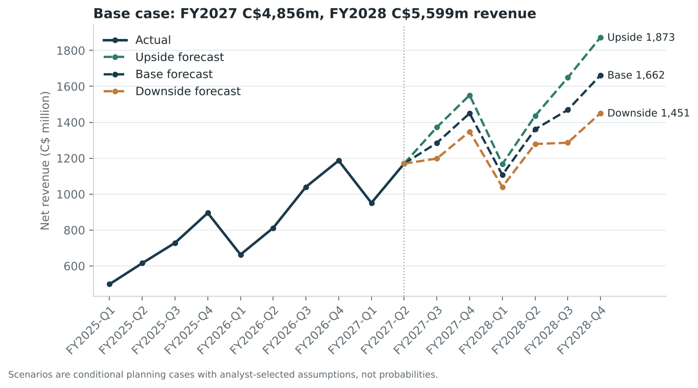

# 6. Forecast: FY2027 and FY2028 revenue and profitability

[← Share](05_share.md) · [README](../README.md)

Actual data through FY2027 Q2 support a Base forecast of **C$4,855.8m revenue and C$977.5m Adjusted EBITDA for FY2027**, followed by **C$5,598.9m revenue and C$1,140.4m Adjusted EBITDA for FY2028**. The planning implication is to support U.S. expansion while controlling gross margin and inventory commitments.

Information cutoff: 12 November 2026. All amounts in C$ million. The model lives in the workbook sheets `Forecast_Assumptions`, `Forecast_Quarterly` and `Forecast_Annual` (change any yellow input and everything recalculates), and it is rebuilt independently in the [notebook](../notebooks/aritzia_analysis.ipynb).

## Scope and accounting basis

- The model forecasts FY2027 Q3 and Q4 and all four FY2028 quarters. FY2027 = reported Q1 and Q2 + forecast Q3 and Q4. FY2028 is entirely forecast.
- U.S. and Canada revenue are modelled separately from the **same quarter of the prior year** to preserve seasonality.
- **Adjusted EBITDA comparability:** FY2026 restated to the FY2027 definition sums to **C$659.670m (17.82%)**. The originally reported C$646.202m uses the earlier definition and is not the comparison base.
- Gross margin excludes tariff refunds. FY2027 H1 Adjusted EBITDA already excludes them, and future refunds are assumed to be zero.

## Scenario results

Base is the central planning case. Downside assumes slower geographic growth, more margin pressure and slower inventory turnover. Upside assumes stronger demand, better expense absorption and faster turnover. These are conditional planning cases, **not** statistical confidence intervals or probabilities.

| Fiscal year | Scenario | Revenue | Growth | Adj. EBITDA | Margin |
|---|---|---:|---:|---:|---:|
| FY2027 | Downside | 4,667.2 | 26.1% | 902.1 | 19.3% |
| FY2028 | Downside | 5,056.4 | 8.3% | 920.9 | 18.2% |
| FY2027 | **Base** | **4,855.8** | **31.2%** | **977.5** | **20.1%** |
| FY2028 | **Base** | **5,598.9** | **15.3%** | **1,140.4** | **20.4%** |
| FY2027 | Upside | 5,044.5 | 36.3% | 1,045.5 | 20.7% |
| FY2028 | Upside | 6,124.0 | 21.4% | 1,292.9 | 21.1% |

In the Base case, FY2027 H2 revenue is **C$2,735.0m** (+22.8% YoY) with **C$539.8m** Adjusted EBITDA (19.7% margin). FY2028 revenue growth moderates to 15.3% while Adjusted EBITDA grows 16.7%. The forecast therefore depends mainly on **sustained revenue growth**, not on a large further step-up in margin.

## Assumptions

U.S. and Canada growth step down from the FY2027 H1 actual pace (about 57.7% and 22.0%). This reflects the analyst view that higher comparison bases and normalising demand will slow reported growth. New boutiques, existing-store performance and Digital demand are built into each region's growth rate rather than forecast as separate additive streams. Quarterly gross margin and SG&A ratios keep the historical seasonal pattern: Q1 carries the highest expense intensity and Q4 the lowest gross margin.

### Base

| Quarter | U.S. growth | Canada growth | Gross margin excl. refunds | SG&A ratio | Reconciliation ratio |
|---|---:|---:|---:|---:|---:|
| FY2027 Q3 | 30.0% | 14.0% | 47.3% | 28.8% | 1.5% |
| FY2027 Q4 | 28.0% | 12.0% | 44.0% | 26.5% | 2.0% |
| FY2028 Q1 | 20.0% | 9.0% | 50.0% | 31.6% | 1.9% |
| FY2028 Q2 | 20.0% | 9.0% | 49.0% | 29.6% | 1.9% |
| FY2028 Q3 | 18.0% | 8.0% | 47.6% | 28.9% | 1.5% |
| FY2028 Q4 | 18.0% | 8.0% | 44.3% | 26.5% | 2.0% |

### Downside

| Quarter | U.S. growth | Canada growth | Gross margin excl. refunds | SG&A ratio | Reconciliation ratio |
|---|---:|---:|---:|---:|---:|
| FY2027 Q3 | 20.0% | 8.0% | 46.4% | 29.4% | 1.5% |
| FY2027 Q4 | 18.0% | 6.0% | 43.0% | 27.0% | 2.0% |
| FY2028 Q1 | 12.0% | 4.0% | 49.0% | 32.4% | 1.9% |
| FY2028 Q2 | 12.0% | 4.0% | 47.5% | 30.4% | 1.9% |
| FY2028 Q3 | 10.0% | 3.0% | 46.2% | 29.7% | 1.5% |
| FY2028 Q4 | 10.0% | 3.0% | 42.7% | 27.2% | 2.0% |

### Upside

| Quarter | U.S. growth | Canada growth | Gross margin excl. refunds | SG&A ratio | Reconciliation ratio |
|---|---:|---:|---:|---:|---:|
| FY2027 Q3 | 40.0% | 20.0% | 48.0% | 28.5% | 1.5% |
| FY2027 Q4 | 38.0% | 18.0% | 44.6% | 26.0% | 2.0% |
| FY2028 Q1 | 28.0% | 12.0% | 50.5% | 31.4% | 1.9% |
| FY2028 Q2 | 28.0% | 12.0% | 49.5% | 29.4% | 1.9% |
| FY2028 Q3 | 26.0% | 10.0% | 48.1% | 28.6% | 1.5% |
| FY2028 Q4 | 26.0% | 10.0% | 44.8% | 26.2% | 2.0% |

### Profit reconciliation

Adjusted EBITDA does not equal gross profit minus SG&A. The model adds an aggregate reconciliation item, calibrated as actual Adjusted EBITDA − gross profit excluding refunds + SG&A. This residual ranged from **1.42% to 2.38% of revenue** in FY2026 Q1 to FY2027 Q2. Future ratios of 1.5% to 2.0% vary by quarter and are the same in all scenarios. It is a simplified planning bridge, not a separate D&A schedule.

## Base quarterly forecast

| Quarter | Status | U.S. revenue | Canada revenue | Total revenue | Adj. EBITDA | Margin |
|---|---|---:|---:|---:|---:|---:|
| FY2027 Q1 | Actual | 638.1 | 312.9 | 951.0 | 191.6 | 20.1% |
| FY2027 Q2 | Actual | 779.4 | 390.4 | 1,169.8 | 246.2 | 21.0% |
| FY2027 Q3 | Forecast | 807.4 | 477.9 | 1,285.3 | 257.1 | 20.0% |
| FY2027 Q4 | Forecast | 966.8 | 483.0 | 1,449.7 | 282.7 | 19.5% |
| FY2028 Q1 | Forecast | 765.7 | 341.1 | 1,106.8 | 224.7 | 20.3% |
| FY2028 Q2 | Forecast | 935.3 | 425.5 | 1,360.8 | 289.9 | 21.3% |
| FY2028 Q3 | Forecast | 952.7 | 516.1 | 1,468.8 | 296.7 | 20.2% |
| FY2028 Q4 | Forecast | 1,140.8 | 521.6 | 1,662.4 | 329.2 | 19.8% |

FY2028 Q3 and Q4 use each scenario's own FY2027 forecast as their prior-year base. Annual margins are calculated from annual dollar totals.

## Comparison with management outlook

As of the FY2027 Q2 release (8 October 2026), management guided to FY2027 revenue of C$4,780 to 4,880m, an Adjusted EBITDA margin of about 20%, Q3 revenue of C$1,275 to 1,325m and about C$250m of net capex.

| Measure | Management outlook | Base forecast | Comparison |
|---|---|---:|---|
| FY2027 revenue | 4,780 to 4,880 | 4,855.8 | Within range; 0.5% above midpoint |
| FY2027 EBITDA margin | ~20.0% | 20.13% | ~13 bps higher |
| FY2027 gross margin excl. refunds | ~47.15% to 47.65% | 47.24% | Within implied range |
| FY2027 SG&A ratio | ~28.6% to 29.1% | 28.92% | Within implied range |
| FY2027 Q3 revenue | 1,275 to 1,325 | 1,285.3 | Lower half of range |
| FY2027 net capex | ~250 | 250.0 | Management plan adopted |

The implied gross-margin and SG&A ranges apply management's stated basis-point changes to rounded prior-year ratios, so they are approximate. Revenue is built from geographic assumptions rather than set to the guidance midpoint. The guidance comparison is a reasonableness check.

At the 27 October 2026 Investor Day, management presented objectives of 15% to 17% annual revenue growth through FY2032 and a 21% Adjusted EBITDA margin. The Base FY2028 forecast is broadly consistent with that direction, but these long-term objectives are not FY2028 guidance.

## Inventory and capex planning

`Average inventory target = annual COGS × inventory days ÷ 364` and `Ending target = 2 × average − opening`. FY2027 opens at **C$495.2m**. FY2027 Q2 actual inventory was C$714.9m.

| Fiscal year | Scenario | Inventory days | Ending inventory target | Inventory build | Net capex |
|---|---|---:|---:|---:|---:|
| FY2027 | Downside | 90 | 732.9 | 237.7 | 250.0 |
| FY2028 | Downside | 95 | 689.7 | −43.2 | 300.0 |
| FY2027 | Base | 80 | 630.9 | 135.8 | 250.0 |
| FY2028 | Base | 80 | 662.7 | 31.7 | 300.0 |
| FY2027 | Upside | 75 | 595.1 | 99.9 | 275.0 |
| FY2028 | Upside | 74 | 702.8 | 107.6 | 350.0 |

- Base FY2027 inventory must fall by about **C$83.9m from Q2 to year end** to reach the target.
- FY2027 capex of C$250m leaves about **C$124.7m for H2** after C$125.3m spent in H1.
- FY2028 Base capex of C$300m is an analyst assumption (20% above FY2027), not company guidance.
- Downside FY2028 inventory *falls* despite slower turnover because the year opens with a high FY2027 balance. This is an opening-balance effect, not better efficiency.

**Not a cash forecast:** cash flow also needs tax, interest, leases, payables, deferred revenue and other working capital. **Adjusted EBITDA − capex − inventory build must not be presented as free cash flow.**

## FY2028 sensitivity

Each sensitivity holds the FY2027 Base forecast fixed and changes only the FY2028 assumption stated. Percentage-point (pp) changes are absolute: +5pp moves 20% growth to 25%.

| FY2028 assumption change | Revenue impact | Adj. EBITDA impact | Inventory impact |
|---|---:|---:|---|
| U.S. growth ±5pp each quarter | ±159.6 | ±32.5 | Depends on resulting COGS |
| Gross margin ±1pp, other ratios fixed | none | ±56.0 | COGS changes the target |
| Inventory days +5, COGS fixed | none | none | +80.9 ending inventory |

| U.S. growth change | GM −1pp | GM unchanged | GM +1pp |
|---|---:|---:|---:|
| −5pp | 1,053.5 | 1,107.9 | 1,162.3 |
| 0pp | 1,084.4 | **1,140.4** | 1,196.4 |
| +5pp | 1,115.3 | 1,172.9 | 1,230.5 |

A combined −5pp U.S. growth and −1pp gross margin reduces FY2028 Adjusted EBITDA by about **C$86.9m (−7.6%)**. **One point of margin matters more than five points of U.S. growth.**

## Benchmark backtest

Two simple revenue benchmarks were tested one quarter ahead over six forecast origins (FY2026 Q1 to FY2027 Q2), each using only information available before the test quarter.

| Benchmark | MAPE | WAPE | Aggregate bias |
|---|---:|---:|---:|
| Prior-year same-quarter revenue (seasonal naive) | 27.4% | 27.6% | −27.6% |
| Latest geographic growth carried forward | 4.3% | 4.7% | −1.0% |

Seasonality alone is inadequate during rapid expansion. Six observations do not validate the scenario assumptions or provide a confidence interval. The Base case deliberately tapers growth rather than extrapolating the latest quarter.

## Decisions and forecast refresh

The U.S. contributes about **79.4% of incremental Base revenue in FY2027** and **81.1% in FY2028**, so U.S. demand and expansion execution are the main planning priorities.

| Planning area | Initial action | Trigger for reassessment |
|---|---|---|
| Revenue | Use Base for the operating plan and keep Downside as a stress case | FY2027 Q3 revenue vs the 1,285.3 Base forecast; investigate variances above 5% |
| Gross margin | Monitor markdowns, freight, tariffs and mix separately | Reforecast if gross margin runs 50 bps below plan (1pp ≈ 56.0 of FY2028 EBITDA) |
| Inventory | Review receipts and purchases against the 80-day annual target | +5 days raises the FY2028 ending target by ~80.9 |
| Capital spending | Review FY2028 commitments against the 300.0 assumption | Re-sequence if demand moves toward Downside |
| Cadence | Replace forecasts with actuals after each quarterly release and roll the horizon forward | Explain volume, mix, margin, expense and inventory variances |

These thresholds are proposed analyst planning controls, not disclosed company policies. Committed capex should be kept distinct from discretionary spending, because a weaker revenue scenario does not automatically reduce committed capex.

## Model formulas

| Calculation | Formula |
|---|---|
| U.S. revenue | Prior-year same-quarter U.S. revenue × (1 + assumed U.S. growth) |
| Canada revenue | Prior-year same-quarter Canada revenue × (1 + assumed Canada growth) |
| Gross profit excl. refunds | Revenue × assumed gross margin |
| SG&A | Revenue × assumed SG&A ratio |
| Reconciliation items | Revenue × assumed reconciliation ratio |
| Adjusted EBITDA | Gross profit excl. refunds − SG&A + reconciliation items |
| Cost of sales | Revenue − gross profit excl. refunds |
| Average inventory target | Annual cost of sales × inventory days ÷ 364 |
| Ending inventory target | 2 × average inventory target − opening inventory |
| MAPE / WAPE | Mean of \|error\| ÷ actual / Σ\|error\| ÷ Σ actual |

## Sources and limits

- Historical actuals: [`Aritzia_FPA_Workbook.xlsx`](../data/Aritzia_FPA_Workbook.xlsx) (`Quarterly`, `Annual`; sources in `Sources`)
- Management outlook: [FY2027 Q2 results, 8 October 2026](https://investors.aritzia.com/investor-news/press-release-details/2026/Aritzia-Reports-Second-Quarter-Fiscal-2027-Financial-Results/default.aspx)
- Long-term context: [Five Year Strategic Plan, 27 October 2026](https://investors.aritzia.com/investor-news/press-release-details/2026/Aritzia-Presents-its-Five-Year-Strategic-Plan-900dc2edd/default.aspx)

The forecast is in reported Canadian dollars, with FX effects built into the geographic growth assumptions. Retail and Digital are an alternative view of the same geographic revenue and must not be added on top. A store-cohort forecast would need opening dates, selling area, comparable-store bases, ramp profiles and channel data by geography. The model does not include EPS, valuation, a full income statement, a balance sheet or a cash-flow forecast.
